# 🇨🇺 adaptive_liquid_glass

[](https://github.com/ledexsoft/adaptive_liquid_glass/actions)
[](https://github.com/ledexsoft/adaptive_liquid_glass/releases)
[](https://opensource.org/licenses/MIT)
[](https://flutter.dev)

**Widgets adaptativos por plataforma para Flutter, listos para usar.**

Escribe tu app **una sola vez** y los componentes (botones, menús, alertas, barras de navegación…) se ven y se sienten **nativos** en cada sistema:

| Plataforma | Qué usan tus widgets |
|---|---|
| 📱 **iOS 26 o superior** | Componentes **nativos de UIKit** con el nuevo diseño **Liquid Glass** (el vidrio translúcido de Apple) |
| 🍎 **iOS 25 o anterior** | Widgets **Cupertino** tradicionales de Flutter |
| 🤖 **Android** | Widgets **Material 3 Expressive** cuando existe una adaptación |

**Sin configurar nada.** El paquete detecta el dispositivo solito y elige el estilo correcto.

---

## 📖 Antes de empezar: 3 conceptos en 1 minuto

1. **Widget** = cada pieza visual de tu app (un botón, un switch, una tarjeta).
2. **Nativo** = el elemento lo dibuja el propio sistema operativo (UIKit en iOS), no Flutter. Por eso se ve y se siente idéntico a las apps de Apple: mismos efectos, mismos haptics, misma tipografía.
3. **Liquid Glass** = el nuevo lenguaje visual de iOS 26: superficies de vidrio translúcido que refractan y difuminan lo que hay detrás. Este paquete lo activa con las APIs públicas de UIKit (`UIButton.Configuration.prominentGlass()`, `UIGlassContainerEffect`, etc.).

> 💡 **La idea del paquete en una frase:** tú escribes `AdaptiveButton`, y en iOS 26 aparece un UIButton real de Apple con vidrio, en Android aparece un botón Material, y en iOS viejo un botón Cupertino. Siempre el correcto, nunca lo piensas.

---

## 📸 Así se ve

<p align="center">
  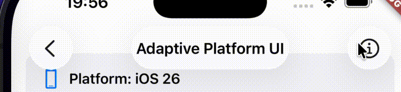
  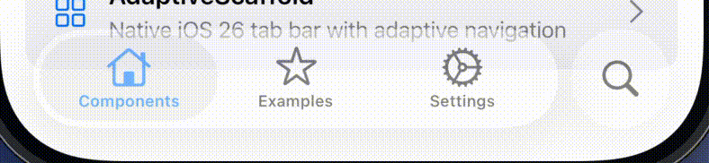
</p>

  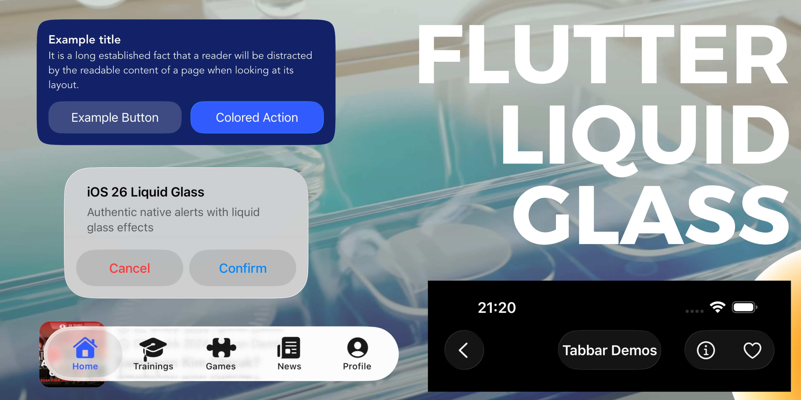

  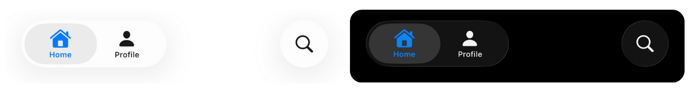

  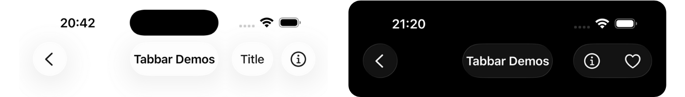


---

## ✅ Requisitos

- Tener **Flutter** instalado (`flutter --version` en una terminal debe responder).
- Flutter **3.47.0 o superior** y Dart **3.12.0 o superior**.
- Saber crear un proyecto (`flutter create mi_app`).
- Nada más. No necesitas saber nada de Swift, Kotlin ni UIKit.

### Material 3 Expressive en Android

Los controles Android del paquete se implementan con Jetpack Compose y **Material 3 Expressive nativo**: botones, selecciones, sliders, FABs, menús, rail, toolbar, pestañas, carrusel, listas, campos de texto, diálogos, selectores, snackbars, tooltips e indicadores. La capa Compose usa `MaterialExpressiveTheme`; el paquete ya no depende ni reexporta widgets Flutter de `material_3_expressive`. iOS mantiene sus rutas Liquid Glass/Cupertino.

La tipografía expresiva para texto Flutter está disponible mediante `AdaptiveExpressiveTypography`: expone los 15 estilos base y sus 15 equivalentes enfatizados, selección por rol y tamaño y asignación de fuentes distintas para títulos y lectura. La extensión no cambia los widgets por sí sola. Al pasarla a `AdaptiveMaterialExpressiveTheme(typography: escala)`, se registra en el tema, se aplica la escala base a Flutter y ambas escalas al tema Compose nativo. `AdaptiveApp` también transmite automáticamente una escala registrada en `materialLightTheme` o `materialDarkTheme`. El puente envía las métricas del `TextTheme` Flutter activo y carga las fuentes declaradas en el proyecto mediante Compose. En Android 8 o posterior también aplica los ejes variables de cada rol tipográfico a esas fuentes. Consulta la [guía de tipografía](docs/expressive-typography.md) para configuración y límites.

Las [formas expresivas](docs/expressive-shapes.md) incluyen el catálogo nativo de 35 polígonos con morph y una escala opcional `AdaptiveExpressiveShapeScale` para los ocho roles reales de `Shapes` en el tema Compose. Los roles no configurados conservan los valores oficiales de Compose.

La ruta nativa requiere Flutter 3.47+, Android `minSdk 24`, `compileSdk 37`, JDK 17+, AGP 9.1.1, Gradle 9.3.1 y Kotlin 2.4.20. El plugin integra Material 3 Compose 1.5.0-rc01, que aporta `MaterialExpressiveTheme` y los componentes expresivos usados aquí.

En Android, `AdaptiveBlurView` no dibuja un blur de Flutter para imitar Liquid Glass: pasa el contenido sin modificar porque esa API no puede desenfocar nativamente el contenido Flutter que queda detrás. `AdaptiveCard.glass` ofrece una superficie Material nativa.

`AdaptiveCarousel` usa los carruseles oficiales de Compose en Android. Declara `androidItems` con datos e iconos `AndroidM3EIcon`; los `Widget` de Flutter no se pueden insertar en un árbol Compose nativo. `AdaptiveSplitButton` recibe `AdaptiveSplitButtonItem`, `AdaptiveToolbar` recibe `AdaptiveToolbarAction` y `AdaptiveButtonGroup` recibe `AdaptiveButtonGroupAction` con iconos serializables. Los menús popup con hijo personalizado mantienen el hijo Flutter como ancla y dibujan el menú en Compose.

En Android, los botones, menús popup, campos de texto, filas adaptativas y acciones de app bar usan controles Material de Flutter como alternativa cuando el contenido personalizado no se puede serializar para Compose; también usan alternativa cuando un menú está en un `Row` sin ancho finito. Así se conservan los widgets y callbacks. Para conservar la app bar nativa, asigna `AdaptiveAppBarAction.androidIcon` a cada acción cuyo `icon` no sea uno de los iconos reconocidos:

```dart
AdaptiveAppBarAction(
  icon: Icons.auto_awesome_outlined, // iOS y otros renderizadores Flutter
  androidIcon: AndroidM3EIcon.autoAwesome, // app bar nativa Compose
  onPressed: onAssistantPressed,
)
```

`AdaptiveButtonGroup` ofrece variantes estándar y conectadas con cinco tamaños M3 Expressive; `selectionRequired` impide vaciar la selección. `AdaptiveFabMenu` admite de dos a seis acciones con etiqueta e icono, y expone `toggleMenuLabel`, `expandedStateLabel` y `collapsedStateLabel` para localización accesible. Consulta [la guía Android de grupos y menús FAB](docs/android-m3e-button-groups-fab-menus.md) para medidas, teclado, RTL y límites de contenido nativo.

`AdaptiveFilterChip` expone el chip de filtro plano o elevado de Compose en Android, con formas nativas para selección y pulsación. Recibe `label`, `selected` y `onSelected`; admite `leadingIcon`/`trailingIcon` para iconos Flutter reconocidos o `nativeLeadingIcon`/`nativeTrailingIcon` para elegir explícitamente un `AndroidM3EIcon`. En otras plataformas usa el `FilterChip` de Flutter.

`AdaptiveInputChip` expone el `InputChip` real de Compose con morph nativo entre sus formas. Admite `label`, `selected`, `onSelected`, icono inicial, `avatarIcon`/`nativeAvatarIcon` o `avatarImageBytes`, y una descripción opcional del avatar. La imagen tiene prioridad sobre el icono de avatar, y cualquier avatar tiene prioridad sobre el icono inicial. También puede usar `onDismiss` en lugar de `onSelected`: al pulsar cualquier parte del chip se descarta el valor y aparece el icono de cerrar. `dismissLabel` permite localizar esa acción; sin él se usa la traducción Material de la app. En otras plataformas usa el `InputChip` de Flutter.

`AdaptiveAssistChip` y `AdaptiveSuggestionChip` usan sus componentes Compose planos o elevados para acciones contextuales; reciben `label`, `onPressed` y los iconos que admite cada componente. Estas API nativas tienen una forma única, sin el morph de selección de los chips de filtro y entrada. En otras plataformas usan `ActionChip` de Flutter.

`AdaptiveDivider` usa el divisor horizontal de Compose en Android; `AdaptiveVerticalDivider` usa el `VerticalDivider` nativo. Este último necesita una altura acotada, por ejemplo dentro de un `Row` contenido en un `SizedBox(height: ...)`. Ambos aceptan grosor, color e insets, y conservan el grosor Material predeterminado cuando no se indica uno.

`AdaptiveToolbar` ofrece las variantes docked y floating nativas. Usa `docked: true` para acciones persistentes de página y `colorStyle: AdaptiveToolbarColorStyle.vibrant` para una barra contextual de mayor énfasis. Las acciones excesivas pasan al menú de desbordamiento de Compose. Revisa [la guía de toolbars Android](docs/android-m3e-toolbars.md) para tamaños, ubicación, accesibilidad y límites del puente Flutter/Compose.

El comportamiento al desplazarse es optativo. Comparte el `ScrollController` de tu lista con la toolbar y elige `pinned`, `exitAlways` o `collapse` (solo floating y con FAB):

```dart
// Créalo y dispónlo dentro del State que posee la lista.
final pageScrollController = ScrollController();

AdaptiveToolbar(
  scrollController: pageScrollController,
  scrollBehavior: AdaptiveToolbarScrollBehavior.exitAlways,
  actions: actions,
)

ListView(controller: pageScrollController, children: items)
```

Para un drawer Android nativo, usa `AdaptiveNavigationDrawer` en `AdaptiveScaffold.drawer` o `endDrawer`, con destinos e iconos serializables. Flutter conserva compatibilidad con `ScaffoldState.openDrawer()` y el gesto de borde; Compose dibuja la hoja, el scrim y la animación del drawer.

```dart
AdaptiveScaffold(
  drawer: AdaptiveNavigationDrawer(
    selectedIndex: selectedIndex,
    onDestinationSelected: selectDestination,
    destinations: const [
      AdaptiveNavigationDrawerDestination(
        label: 'Inicio',
        icon: AndroidM3EIcon.home,
      ),
    ],
  ),
  body: const HomePage(),
)
```

Los FABs e iconos Android aceptan los iconos Material comunes como `Icon(Icons.add)`. Para otros iconos o hijos personalizados, pasa un `AndroidM3EIcon` mediante `nativeIcon` (y `nativeSelectedIcon` cuando corresponda); Compose no puede dibujar un árbol `Widget` de Flutter dentro de una vista nativa.

El destello de IA es optativo y nunca se añade automáticamente. Usa `AdaptiveAiSparkleIcon` para decorar un icono, o `aiPowered: true` en `AdaptiveIconButton` y `AdaptiveFloatingActionButton`. En Android, el distintivo se dibuja en Compose. Añade una etiqueta que explique la acción (por ejemplo, “Resumir con IA”); el destello por sí solo no describe qué hará la IA.

```dart
AdaptiveIconButton(
  icon: const Icon(Icons.mic),
  aiPowered: true,
  tooltip: 'Transcribir con IA',
  onPressed: transcribe,
)
```

En Android, `AdaptiveIconButton` usa las cinco alturas M3 Expressive (32, 40, 56, 96 y 136 dp) y `AdaptiveIconButtonWidth.narrow`, `defaultWidth` o `wide`. Compose aplica el tamaño oficial del icono salvo que el `Icon` tenga tamaño o color explícitos, y transforma la forma al pulsar o seleccionar; el área anfitriona mide al menos 48 dp. Por ejemplo:

```dart
AdaptiveIconButton(
  icon: const Icon(Icons.favorite_border),
  selectedIcon: const Icon(Icons.favorite),
  isSelected: liked,
  size: AdaptiveIconButtonSize.medium,
  width: AdaptiveIconButtonWidth.wide,
  shape: AdaptiveIconButtonShape.round,
  semanticLabel: 'Favorito',
  onPressed: toggleLiked,
)
```

Para un botón con contador, usa `badgeValue: 3` y `badgeSemanticsLabel: '3 avisos sin leer'`. La etiqueta del botón puede venir de `semanticLabel`, de `tooltip` o del `semanticLabel` de su `Icon`, en ese orden. Android dibuja el distintivo y expone su descripción en el árbol de accesibilidad de Compose.

Si tu aplicación usa un `MaterialApp` propio, puedes envolver su `builder` con `AdaptiveMaterialExpressiveTheme` para propagar tema, brillo y color semilla a las vistas Compose del paquete. Android 12+ usa por defecto la paleta dinámica del fondo de pantalla. Android 7–11 usa primero el `lightTheme` o `darkTheme` proporcionado; si indicas `seedColor`, aplica la misma paleta expresiva al contenido Flutter y a los controles nativos; en los demás casos genera una paleta expresiva desde el primario del tema. La variante expresiva puede desplazar el tono de la semilla. Configura `dynamicColoring: false` para usar el `ColorScheme` efectivo del tema Flutter en los controles nativos.

`AdaptiveApp` y `AdaptiveApp.router` también aceptan `dynamicColoring`. Déjalo en `true` para conservar la paleta del wallpaper en Android 12+; usa `false` cuando tu app ya configura el `ColorScheme` Flutter (por ejemplo, para respetar variantes y niveles de contraste elegidos por el usuario) y quieras que Compose use exactamente ese esquema.

```dart
MaterialApp(
  builder: (context, child) => AdaptiveMaterialExpressiveTheme(
    child: child ?? const SizedBox.shrink(),
  ),
)
```

Las opciones de Android deben poder representarse como datos simples o iconos serializables. Para títulos, prefijos o acciones con árboles arbitrarios de Flutter, el paquete conserva contenido Flutter cuando la API lo permite; una vista Compose no puede ejecutar widgets Flutter dentro de su árbol nativo. Consulta [la matriz de cobertura Android](docs/android-m3e-native-coverage.md) para ver las rutas híbridas y los límites de serialización.

---

## 📦 Paso 1: Instalar el paquete

El paquete se instala **directamente desde este repositorio de GitHub**:

1. Abre el archivo `pubspec.yaml` de tu proyecto.
2. Debajo de `dependencies:` agrega:

```yaml
dependencies:
  adaptive_liquid_glass:
    git:
      url: https://github.com/ledexsoft/adaptive_liquid_glass.git
      ref: v0.2.16
```

3. En la terminal, dentro de la carpeta de tu proyecto:

```bash
flutter pub get
```

> 💡 **¿Qué es el `ref`?** Apunta a un **tag** del repositorio (versión congelada). Cada versión nueva del paquete publica su tag (por ejemplo, `v0.2.16`). Así tu app nunca cambia sin que tú lo decidas: actualizas solo cuando cambias ese número.
>
> 🔎 Puedes ver todas las versiones disponibles en: https://github.com/ledexsoft/adaptive_liquid_glass/tags

---

## 🚀 Paso 2: Tu primera app en 5 minutos

1. Crea el proyecto:

```bash
flutter create mi_app
cd mi_app
flutter pub add adaptive_liquid_glass
```

2. Reemplaza todo el contenido de `lib/main.dart` con esto:

```dart
import 'package:adaptive_liquid_glass/adaptive_liquid_glass.dart';
import 'package:flutter/material.dart';

void main() {
  runApp(const MiApp());
}

class MiApp extends StatelessWidget {
  const MiApp({super.key});

  @override
  Widget build(BuildContext context) {
    // AdaptiveApp = el "andamio" que configura temas nativos por plataforma.
    return AdaptiveApp(
      title: 'Mi App',
      themeMode: ThemeMode.system,
      materialLightTheme: ThemeData.light(),
      materialDarkTheme: ThemeData.dark(),
      cupertinoLightTheme: const CupertinoThemeData(
        brightness: Brightness.light,
      ),
      cupertinoDarkTheme: const CupertinoThemeData(
        brightness: Brightness.dark,
      ),
      home: const Inicio(),
    );
  }
}

class Inicio extends StatelessWidget {
  const Inicio({super.key});

  @override
  Widget build(BuildContext context) {
    // AdaptiveScaffold = la estructura de la pantalla (barra superior + cuerpo).
    return AdaptiveScaffold(
      appBar: AdaptiveAppBar(
        title: 'Mi App',
        useNativeToolbar: true, // Barra nativa de iOS 26 con Liquid Glass
      ),
      body: Center(
        child: Column(
          mainAxisAlignment: MainAxisAlignment.center,
          children: [
            // Un botón: nativo en cada plataforma, sin configurar nada.
            AdaptiveButton(
              onPressed: () {},
              label: 'Mi primer botón',
            ),
            const SizedBox(height: 16),
            AdaptiveSwitch(
              value: true,
              onChanged: (value) {},
            ),
          ],
        ),
      ),
    );
  }
}
```

3. Ejecuta:

```bash
flutter run
```

🎉 Listo. En un iPhone con iOS 26 verás la barra y el botón con Liquid Glass reales; en Android, Material 3; en iOS viejo, Cupertino. **El mismo código.**

### ¿Y si uso un router (GoRouter)?

```dart
AdaptiveApp.router(
  routerConfig: router,
  title: 'Mi App',
  themeMode: ThemeMode.system,
  materialLightTheme: ThemeData.light(),
  materialDarkTheme: ThemeData.dark(),
  cupertinoLightTheme: const CupertinoThemeData(
    brightness: Brightness.light,
  ),
  cupertinoDarkTheme: const CupertinoThemeData(
    brightness: Brightness.dark,
  ),
)
```

---

## 🔘 Los botones en iOS 26: cómo se comportan

En iOS 26+ los botones usan **Liquid Glass nativo**. Cada estilo conserva su **jerarquía** y **su propio color** (el vidrio se tiñe con el `color:` que le pases; si no le pasas color, usa el color primario de tu tema):

| Estilo | Para qué sirve | En iOS 26+ se ve como |
|---|---|---|
| `filled` | **Acción primaria** (lo más importante de la pantalla) | Cápsula de vidrio **prominente** |
| `tinted` | **Acción secundaria** común | Cápsula de vidrio **prominente** con su color |
| `bordered` | Botón con borde | Cápsula de vidrio **prominente** con su color |
| `gray` | Acción neutra | Vidrio **discreto** (más sutil) |
| `glass` | Vidrio explícito | Vidrio discreto |
| `plain` | Solo texto, sin fondo | Texto sin fondo |

**En iOS 25 o anterior** los mismos estilos caen automáticamente a sus equivalentes Cupertino. **En Android** usan botones nativos Material 3 Expressive.

```dart
// Acción primaria — glass prominente en iOS 26+
AdaptiveButton(
  onPressed: () {},
  style: AdaptiveButtonStyle.filled,
  label: 'Guardar',
)

// Secundaria — glass prominente con SU color (no el primario)
AdaptiveButton(
  onPressed: () {},
  style: AdaptiveButtonStyle.tinted,
  color: Colors.green, // verde, no azul
  label: 'Confirmar',
)

// Sin fondo (texto)
AdaptiveButton(
  onPressed: () {},
  style: AdaptiveButtonStyle.plain,
  label: 'Cancelar',
)
```

### Tamaños

```dart
AdaptiveButton(onPressed: () {}, size: AdaptiveButtonSize.small, label: 'Small');  // iOS 28pt; Android 40dp
AdaptiveButton(onPressed: () {}, size: AdaptiveButtonSize.medium, label: 'Medium'); // iOS 36pt; Android 56dp (default)
AdaptiveButton(onPressed: () {}, size: AdaptiveButtonSize.large, label: 'Large');   // iOS 44pt; Android 96dp

// Solo Android: acceso explícito a los cinco tamaños Material 3 Expressive.
AdaptiveButton(onPressed: () {}, androidSize: AdaptiveAndroidButtonSize.extraSmall, label: 'XS'); // 32dp
AdaptiveButton(onPressed: () {}, androidSize: AdaptiveAndroidButtonSize.extraLarge, label: 'XL'); // 136dp
```

### Estilos personalizados y deshabilitado

```dart
AdaptiveButton(
  onPressed: () {},
  label: 'Personalizado',
  color: Colors.red,
  padding: EdgeInsets.symmetric(horizontal: 24, vertical: 12),
  borderRadius: BorderRadius.circular(16),
  minSize: Size(200, 50),
)

AdaptiveButton(
  onPressed: () {},
  label: 'Deshabilitado',
  enabled: false,
)

AdaptiveButton.child(
  onPressed: () {},
  child: Text(
    'Guardar',
    style: TextStyle(fontSize: 18, fontWeight: FontWeight.w600),
  ),
)
```

En Android, `AdaptiveButton.child` conserva el botón Compose y sus animaciones con `Text` de estilo compatible, incluso junto a un icono en un `Row` simple. Una fuente personalizada u otro efecto de texto que Compose no pueda representar mantiene el hijo Flutter.

---

## 🧰 Galería de widgets

Todos los widgets siguen el mismo patrón: **un solo nombre, tres aspectos nativos**.

### Importante: localización

⚠️ Para que los date/time pickers y diálogos salgan en el idioma del usuario, agrega los delegates a tu `AdaptiveApp`:

```dart
import 'package:flutter_localizations/flutter_localizations.dart';

AdaptiveApp(
  localizationsDelegates: [
    GlobalMaterialLocalizations.delegate,
    GlobalCupertinoLocalizations.delegate, // ¡Importante!
    GlobalWidgetsLocalizations.delegate,
  ],
  supportedLocales: [
    Locale('es', ''), // Español
    Locale('en', ''),
    // Agrega los que necesites
  ],
)
```

### AdaptiveScaffold + AdaptiveAppBar (la estructura de cada pantalla)

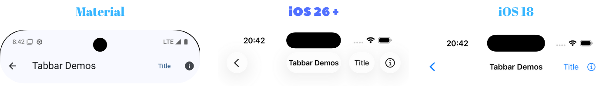

```dart
AdaptiveScaffold(
  appBar: AdaptiveAppBar(
    title: 'Mi App',
    useNativeToolbar: true, // UIToolbar nativa de iOS 26 con Liquid Glass
    actions: [
      AdaptiveAppBarAction(
        onPressed: () {},
        iosSymbol: 'gear', // SF Symbol en iOS 26+
        icon: Icons.settings, // Fallback para otras plataformas
      ),
    ],
  ),
  bottomNavigationBar: AdaptiveBottomNavigationBar(
    useNativeBottomBar: true, // UITabBar nativa de iOS 26 (default)
    androidStyle: AdaptiveAndroidNavigationBarStyle.short, // Compose M3 Expressive
    items: [
      AdaptiveNavigationDestination(icon: 'house.fill', label: 'Inicio'),
      AdaptiveNavigationDestination(icon: 'magnifyingglass', label: 'Buscar'),
      AdaptiveNavigationDestination(icon: 'person.fill', label: 'Perfil'),
    ],
    selectedIndex: 0,
    onTap: (index) {},
  ),
  body: TuContenido(),
)
```

**Características clave:**
- 🎨 **AdaptiveAppBar**: configuración centralizada de la barra superior
- 📱 **AdaptiveBottomNavigationBar**: navegación inferior centralizada
- 🌟 **Componentes nativos de iOS 26**: Liquid Glass con UIKit real
- 🔄 **Flexible**: si pasas algo en null, simplemente no se muestra

En Android puedes elegir las variantes nativas de Material 3 Expressive. Usa
`mediumFlexible` o `largeFlexible` para títulos que colapsan al desplazarte, o
`search` para abrir la vista de búsqueda nativa de Compose. Consulta la
[guía de app bars Android](docs/android-m3e-app-bars.md) para búsqueda,
sugerencias, acciones destacadas, logos y accesibilidad.

```dart
AdaptiveAppBar(
  variant: AdaptiveAppBarVariant.mediumFlexible,
  title: 'Mis podcasts',
  subtitle: '12 episodios',
  scrollBehavior: AdaptiveAppBarScrollBehavior.exitUntilCollapsed,
  actions: [
    AdaptiveAppBarAction(
      icon: Icons.bookmark,
      semanticLabel: 'Guardar podcast',
      androidStyle: AdaptiveAppBarActionStyle.filledTonal,
      onPressed: savePodcast,
    ),
  ],
)
```

Bottom Navigation Bar adaptativa:
<p align="center">
  
</p>

`AdaptiveSplitButton` usa el split button nativo M3 Expressive en Android, con
cinco tamaños, cuatro estilos y menú accesible. Revisa la
[guía de split buttons Android](docs/android-m3e-split-buttons.md) para las
alturas, targets táctiles y etiquetas del botón de opciones.

```dart
AdaptiveSplitButton<String>(
  label: 'Guardar',
  size: AdaptiveSplitButtonSize.small,
  style: AdaptiveSplitButtonStyle.tonal,
  menuButtonSemanticLabel: 'Más opciones para guardar',
  items: const [
    AdaptiveSplitButtonItem(value: 'copy', label: 'Guardar una copia'),
  ],
  onPressed: guardar,
  onSelected: guardarConOpcion,
)
```

`AdaptiveProgressIndicator` ofrece progreso lineal y circular en Android Compose,
con estado determinado/indeterminado, forma plana u ondulada y etiquetas para
lectores de pantalla. Consulta la
[guía de indicadores Android](docs/android-m3e-progress-indicators.md).

### AdaptiveAlertDialog (diálogos de alerta)

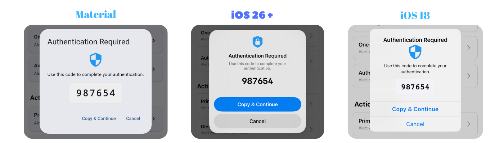

```dart
AdaptiveAlertDialog.show(
  context: context,
  title: 'Confirmar',
  message: '¿Seguro que quieres continuar?',
  icon: 'checkmark.circle.fill',
  actions: [
    AlertAction(
      title: 'Cancelar',
      style: AlertActionStyle.cancel,
      onPressed: () {},
    ),
    AlertAction(
      title: 'Confirmar',
      style: AlertActionStyle.primary,
      onPressed: () {},
    ),
  ],
);

// Con campo de texto: el resultado es lo que escribió el usuario
final result = await AdaptiveAlertDialog.show(
  context: context,
  title: 'Tu nombre',
  message: 'Escríbelo aquí',
  icon: 'person.fill',
  input: AdaptiveAlertDialogInput(
    placeholder: 'Nombre',
    keyboardType: TextInputType.text,
  ),
  actions: [
    AlertAction(title: 'Cancelar', style: AlertActionStyle.cancel, onPressed: () {}),
    AlertAction(title: 'Enviar', style: AlertActionStyle.primary, onPressed: () {}),
  ],
);
if (result != null) {
  print('Escribió: $result');
}
```

### AdaptiveContextMenu (menú de presión larga)

```dart
AdaptiveContextMenu(
  actions: [
    AdaptiveContextMenuAction(
      title: 'Editar',
      icon: PlatformInfo.isIOS ? CupertinoIcons.pencil : Icons.edit,
      onPressed: () {},
    ),
    AdaptiveContextMenuAction(
      title: 'Eliminar',
      icon: PlatformInfo.isIOS ? CupertinoIcons.trash : Icons.delete,
      isDestructive: true,
      onPressed: () {},
    ),
  ],
  child: Container(
    padding: EdgeInsets.all(16),
    child: Text('Mantén presionado'),
  ),
)
```

**iOS**: `CupertinoContextMenu` con preview y animaciones nativas. **Android**: menú contextual nativo de Compose. **macOS/Linux/Windows**: menú emergente Material de Flutter.

### AdaptivePopupMenuButton (menú popup)

<p align="center">
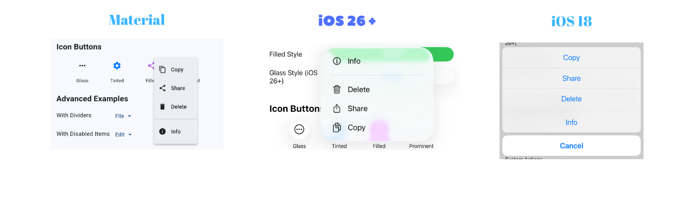
</p>

```dart
AdaptivePopupMenuButton.text<String>(
  label: 'Opciones',
  items: [
    AdaptivePopupMenuItem(
      label: 'Editar',
      icon: PlatformInfo.isIOS26OrHigher() ? 'pencil' : Icons.edit,
      value: 'edit',
    ),
    AdaptivePopupMenuItem(
      label: 'Eliminar',
      icon: PlatformInfo.isIOS26OrHigher() ? 'trash' : Icons.delete,
      value: 'delete',
    ),
  ],
  onSelected: (index, item) {
    print('Seleccionó: ${item.value}');
  },
)
```

### AdaptiveSegmentedControl (control segmentado)

<p align="center">
  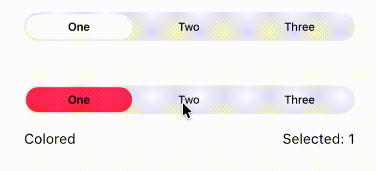
</p>

```dart
AdaptiveSegmentedControl(
  labels: ['Uno', 'Dos', 'Tres'],
  selectedIndex: 0,
  onValueChanged: (index) {
    print('Seleccionó: $index');
  },
)

// Con SF Symbols en iOS
AdaptiveSegmentedControl(
  labels: [],
  sfSymbols: ['house.fill', 'person.fill', 'gear'],
  selectedIndex: 0,
  onValueChanged: (index) {},
)

// Con iconos Material nativos en Android: nombres localizados obligatorios
AdaptiveSegmentedControl(
  labels: [],
  sfSymbols: [AndroidM3EIcon.home, AndroidM3EIcon.favorite],
  semanticLabels: ['Inicio', 'Favoritos'],
  selectedIndex: 0,
  onValueChanged: (index) {},
)
```

### AdaptiveSwitch, AdaptiveSlider y AdaptiveRangeSlider

<p align="center">
  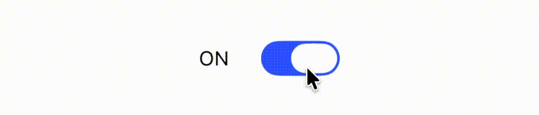
  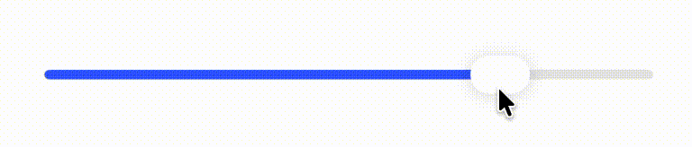
</p>

```dart
AdaptiveSwitch(
  value: true,
  onChanged: (value) {
    print('Switch: $value');
  },
)

AdaptiveSlider(
  value: 0.5,
  onChanged: (value) {
    print('Slider: $value');
  },
  min: 0.0,
  max: 1.0,
)

AdaptiveSlider.vertical(
  height: 240,
  value: 0.5,
  topToBottom: false, // el valor mínimo queda abajo
  centeredTrack: true, // pista nativa que parte del centro en Android
  onChanged: (value) => print('Vertical: $value'),
)

AdaptiveRangeSlider(
  // selectedRange pertenece al State del widget y empieza, por ejemplo,
  // con const RangeValues(0.2, 0.8).
  values: selectedRange,
  min: 0.0,
  max: 1.0,
  onChanged: (range) => setState(() => selectedRange = range),
)
```

`AdaptiveSlider.vertical` usa `VerticalSlider` real de Compose en Android, con pulgar, etiqueta, colores, pasos y estados nativos. Requiere una altura finita y reserva al menos 48 dp de ancho para el área táctil. `centeredTrack: true` también está disponible en el slider horizontal y selecciona `SliderDefaults.CenteredTrack` de Compose; por defecto se mantiene la pista normal. En iOS y otras plataformas, el slider vertical usa un control Flutter orientado verticalmente y `centeredTrack` no altera su pista.

### AdaptiveCheckbox y AdaptiveRadio

```dart
AdaptiveCheckbox(
  value: true,
  onChanged: (value) {
    print('Checkbox: $value');
  },
)

// Tristate: true, false o null
AdaptiveCheckbox(
  value: null,
  tristate: true,
  onChanged: (value) {},
)

// Radio buttons
enum Options { opcion1, opcion2, opcion3 }
Options? _seleccion = Options.opcion1;

AdaptiveRadio<Options>(
  value: Options.opcion1,
  groupValue: _seleccion,
  onChanged: (Options? value) {
    setState(() {
      _seleccion = value;
    });
  },
)
```

### AdaptiveCard (tarjetas)

```dart
AdaptiveCard(
  padding: EdgeInsets.all(16),
  child: Text('Contenido de la tarjeta'),
)

// Variantes Material 3 reales en Android; en Flutter se usan Card.filled,
// Card y Card.outlined. Sin style se conserva el aspecto anterior.
AdaptiveCard(
  style: AdaptiveCardStyle.outlined,
  padding: EdgeInsets.all(16),
  child: Text('Tarjeta con contorno'),
)

// Con estilo personalizado
AdaptiveCard(
  padding: EdgeInsets.all(16),
  color: Colors.blue.withValues(alpha: 0.1),
  borderRadius: BorderRadius.circular(20),
  elevation: 8, // Solo Android
  child: Column(
    children: [
      Text('Tarjeta personalizada'),
      Text('Con varios elementos'),
    ],
  ),
)
```

### AdaptiveBadge (insignias de notificación)

```dart
AdaptiveBadge(
  count: 5,
  child: Icon(Icons.notifications),
)

AdaptiveBadge(
  label: 'NUEVO',
  backgroundColor: Colors.red,
  child: Icon(Icons.mail),
)
```

### AdaptiveSearchBar

```dart
AdaptiveSearchBar(
  hintText: 'Buscar noticias',
  androidSuggestions: const ['Cuba', 'Economía', 'Cultura'],
  onChanged: filtrarSugerencias,
  onAndroidSuggestionSelected: abrirResultado,
)
```

En Android, `androidSuggestions` activa el `SearchBar` y la vista expandida
nativos de Compose. Si no se indica, el campo conserva su comportamiento
compacto. En ventanas de menos de 600 dp, Compose usa
`ExpandedFullScreenSearchBar`; desde 600 dp usa `ExpandedDockedSearchBar`.
Si cambia el ancho mientras está abierta, conserva la vista actual hasta
cerrarse. La selección se entrega después de la animación de cierre.

### AdaptiveTooltip

```dart
AdaptiveTooltip(
  message: 'Este es un tooltip',
  child: Icon(Icons.info),
)

// Que aparezca arriba en vez de abajo
AdaptiveTooltip(
  message: 'Tooltip arriba',
  preferBelow: false,
  child: Icon(Icons.help),
)

// Android: usar la posición lateral nativa de Compose (respeta RTL).
AdaptiveTooltip(
  message: 'Más opciones',
  androidPosition: AdaptiveTooltipAnchorPosition.end,
  androidSpacing: 8,
  child: Icon(Icons.more_vert),
)

// Android: RichTooltip nativo con título y acción opcionales.
AdaptiveTooltip(
  message: 'Conoce cómo funciona esta opción.',
  androidTitle: 'Más información',
  androidCaret: true,
  androidActionLabel: 'Abrir guía',
  onAndroidAction: () => abrirGuia(),
  child: Icon(Icons.info_outline),
)
```

### AdaptiveSnackBar (mensajes tipo notificación)

```dart
// Básico
AdaptiveSnackBar.show(
  context,
  message: '¡Operación completada!',
  type: AdaptiveSnackBarType.success,
)

// Con botón de acción
AdaptiveSnackBar.show(
  context,
  message: 'Archivo eliminado',
  type: AdaptiveSnackBarType.info,
  action: 'Deshacer',
  onActionPressed: () {
    // Deshacer
  },
)

// Tipos disponibles
AdaptiveSnackBar.show(context, message: 'Info', type: AdaptiveSnackBarType.info);
AdaptiveSnackBar.show(context, message: 'Éxito', type: AdaptiveSnackBarType.success);
AdaptiveSnackBar.show(context, message: 'Advertencia', type: AdaptiveSnackBarType.warning);
AdaptiveSnackBar.show(context, message: 'Error', type: AdaptiveSnackBarType.error);
```

**iOS**: banner arriba con animaciones y descarte al tocar. **Android**: Material SnackBar abajo.

### AdaptiveDatePicker y AdaptiveTimePicker (fechas y horas)

```dart
// Fecha
final fecha = await AdaptiveDatePicker.show(
  context: context,
  initialDate: DateTime.now(),
  firstDate: DateTime(2020),
  lastDate: DateTime(2030),
);

// Hora (formato 24h)
final hora = await AdaptiveTimePicker.show(
  context: context,
  initialTime: TimeOfDay.now(),
  use24HourFormat: true,
);

if (fecha != null) {
  print('Fecha: $fecha');
}
```

**iOS**: `CupertinoDatePicker` en un bottom sheet con Cancelar/Listo. **Android**: diálogos de Material.

### AdaptiveListTile (filas de lista)

```dart
AdaptiveListTile(
  leading: Icon(Icons.person),
  title: Text('Perfil'),
  subtitle: Text('Ver tu perfil'),
  trailing: Icon(Icons.chevron_right),
  onTap: () {
    // Manejar tap
  },
)

// Con switch integrado
AdaptiveListTile(
  title: Text('Activar función'),
  trailing: AdaptiveSwitch(
    value: switchValue,
    onChanged: (value) {},
  ),
)
```

En Android, usa `androidSegmentIndex` y `androidSegmentCount` para el
[`SegmentedListItem` nativo](docs/android-m3e-lists.md). Indica la posición y el
total en cada fila; el paquete aplica la forma y la separación de Compose.

### AdaptiveTextField y AdaptiveTextFormField (texto y formularios)

```dart
// Campo de texto básico
AdaptiveTextField(
  placeholder: 'Ingresa tu nombre',
  onChanged: (value) {
    print('Texto: $value');
  },
)

// Contraseña
AdaptiveTextField(
  placeholder: 'Contraseña',
  obscureText: true,
  prefixIcon: Icon(
    PlatformInfo.isIOS ? CupertinoIcons.lock : Icons.lock,
  ),
)

// Campo de formulario con validación
AdaptiveTextFormField(
  placeholder: 'Email',
  keyboardType: TextInputType.emailAddress,
  validator: (value) {
    if (value == null || value.isEmpty) {
      return 'Ingresa tu email';
    }
    if (!value.contains('@')) {
      return 'Email no válido';
    }
    return null;
  },
  onSaved: (value) => _email = value,
)
```

### AdaptiveFloatingActionButton (botón flotante)

```dart
AdaptiveFloatingActionButton(
  onPressed: () {},
  tooltip: 'Crear',
  child: Icon(Icons.add),
)

AdaptiveFloatingActionButton(
  onPressed: () {},
  mini: true,
  tooltip: 'Editar',
  child: Icon(Icons.edit),
)

// Tamaño expresivo mediano de Android (80 dp), con el FAB real de Compose.
AdaptiveFloatingActionButton(
  onPressed: () {},
  androidSize: AdaptiveAndroidFabSize.medium,
  tooltip: 'Crear',
  child: Icon(Icons.add),
)
```

En Android, `androidSize` admite `small` (40 dp), `standard` (56 dp),
`medium` (80 dp) y `large` (96 dp). Tiene prioridad sobre `mini`; si se omite,
`mini` conserva su comportamiento anterior. Este ajuste no cambia iOS.
El tamaño `small` conserva su visual de 40 dp y reserva un área de 48 dp para
el objetivo táctil nativo.
Cada FAB nativo de Android necesita un `tooltip` o un
`Icon.semanticLabel` no vacío para que la acción tenga nombre accesible.

### AdaptiveFormSection y AdaptiveExpansionTile (formularios agrupados y acordeones)

```dart
// Sección agrupada (estilo Ajustes de iOS)
AdaptiveFormSection.insetGrouped(
  header: Text('Ajustes'),
  children: [
    CupertinoFormRow(
      prefix: Text('Notificaciones'),
      child: AdaptiveSwitch(value: true, onChanged: (v) {}),
    ),
  ],
)

// Acordeón expandible
AdaptiveExpansionTile(
  leading: Icon(Icons.settings),
  title: Text('Ajustes avanzados'),
  subtitle: Text('Toca para expandir'),
  children: [
    ListTile(title: Text('Opción 1')),
    ListTile(title: Text('Opción 2')),
  ],
)
```

### AdaptiveTabBarView (tabs deslizables)

```dart
AdaptiveTabBarView(
  tabs: ['Recientes', 'Populares', 'Tendencias'],
  children: [
    RecientesPage(),
    PopularesPage(),
    TendenciasPage(),
  ],
  onTabChanged: (index) {
    print('Tab: $index');
  },
)
```

En Android, las pestañas usan filas nativas de Compose Material 3. El valor
predeterminado es la fila primaria con texto. Puedes elegir la fila secundaria,
añadir iconos nativos o mostrar solo iconos:

```dart
AdaptiveTabBarView(
  tabs: ['Inicio', 'Ajustes'], // Nombres accesibles, incluso sin texto visible
  androidRowStyle: AdaptiveTabRowStyle.secondary,
  androidIcons: [AndroidM3EIcon.home, AndroidM3EIcon.settings],
  androidShowLabels: false,
  children: [InicioPage(), AjustesPage()],
)
```

Estas opciones afectan solo a Android; iOS conserva su control segmentado.

---

## 🔍 Detectar plataforma y versión de iOS

```dart
import 'package:adaptive_liquid_glass/adaptive_liquid_glass.dart';

if (PlatformInfo.isIOS) {
  print('Estamos en iOS');
}

if (PlatformInfo.isAndroid) {
  print('Estamos en Android');
}

// ¿iOS 26 o superior? (Liquid Glass disponible)
if (PlatformInfo.isIOS26OrHigher()) {
  print('Usando funciones de iOS 26+');
}

// ¿Versión vieja? (widgets Cupertino)
if (PlatformInfo.isIOS18OrLower()) {
  print('Usando widgets legacy');
}

// Número de versión y rangos
int version = PlatformInfo.iOSVersion; // ej. 26
if (PlatformInfo.isIOSVersionInRange(24, 26)) {
  print('Entre iOS 24 y 26');
}

String descripcion = PlatformInfo.platformDescription; // ej. "iOS 26"
```

---

## 🛠️ Cómo funciona por dentro (para los curiosos)

- En **iOS 26+**, los widgets se renderizan con **platform views nativas** (`UiKitView`): son componentes reales de UIKit incrustados en Flutter, comunicados por platform channels. El Liquid Glass lo dibuja UIKit, no Flutter.
- En **iOS 25-**, se usan widgets Cupertino tradicionales (el paquete **no obliga** a subir el deployment target de tu app a iOS 26).
- En **Android**, Material 3 puro.
- **Agrupación de vidrio**: superficies nativas cercanas pueden fundirse en sus bordes con `UIGlassContainerEffect`, pero solo si viven dentro de la misma platform view; UIKit no puede fusionar platform views separadas de Flutter.

---

## ⚠️ IOS26NativeSearchTabBar (EXPERIMENTAL — no la uses en producción)

(No confundir con `AdaptiveBottomNavigationBar`.)

Search tab bar nativa de iOS 26+ con UITabBarController que transforma la tab en una barra de búsqueda al seleccionarla:

```dart
import 'package:adaptive_liquid_glass/adaptive_liquid_glass.dart';

await IOS26NativeSearchTabBar.enable(
  tabs: [
    const NativeTabConfig(title: 'Home', sfSymbol: 'house.fill'),
    const NativeTabConfig(
      title: 'Search',
      sfSymbol: 'magnifyingglass',
      isSearchTab: true, // Esta tab se transforma en búsqueda
    ),
    const NativeTabConfig(title: 'Profile', sfSymbol: 'person.fill'),
  ],
  selectedIndex: 0,
  onTabSelected: (index) {},
  onSearchQueryChanged: (query) {},
  onSearchSubmitted: (query) {},
  onSearchCancelled: () {},
);

// Desactivar al terminar
await IOS26NativeSearchTabBar.disable();
```

**¿Por qué es experimental?** Reemplaza el root view controller de Flutter por una UITabBarController nativa, y eso choca con la arquitectura de Flutter: el ciclo de vida de los widgets puede fallar, `Navigator.pop()` se vuelve poco confiable, el estado (Provider/Riverpod/Bloc) puede perderse, el hot reload no funciona y puede haber fugas de memoria.

**En resumen:** ✅ para prototipos y demos. ❌ para producción.

---

## 📋 Catálogo completo

- ✅ **AdaptiveApp** — Configuración de la app por plataforma (temas + router)
- ✅ **AdaptiveAppBar** — Barra superior centralizada
- ✅ **AdaptiveBottomNavigationBar** — Navegación inferior centralizada
- ✅ **AdaptiveScaffold** — Estructura de pantalla con toolbar/tab bar nativas opcionales
- ✅ **AdaptiveButton** — Botones nativos de iOS 26+
- ✅ **AdaptiveSegmentedControl** — Controles segmentados nativos
- ✅ **AdaptiveSwitch** — Switches nativos
- ✅ **AdaptiveSlider** — Sliders nativos
- ✅ **AdaptiveRangeSlider** — Selector de rango nativo de Compose en Android
- ✅ **AdaptiveCheckbox** — Checkboxes adaptativos
- ✅ **AdaptiveRadio** — Radio buttons adaptativos
- ✅ **AdaptiveCard** — Tarjetas por plataforma
- ✅ **AdaptiveBadge** — Insignias de notificación
- ✅ **AdaptiveTooltip** — Tooltips por plataforma
- ✅ **AdaptiveSnackBar** — Notificaciones por plataforma
- ✅ **AdaptiveAlertDialog** — Alertas nativas con campo de texto
- ✅ **AdaptiveContextMenu** — Menús contextuales de presión larga
- ✅ **AdaptivePopupMenuButton** — Menús popup nativos
- ✅ **AdaptiveDatePicker** — Selector de fechas por plataforma
- ✅ **AdaptiveTimePicker** — Selector de horas por plataforma
- ✅ **AdaptiveListTile** — Tiles de lista por plataforma
- ✅ **AdaptiveTextField** — Campos de texto por plataforma
- ✅ **AdaptiveTextFormField** — Campos de formulario con validación
- ✅ **AdaptiveFloatingActionButton** — Botones flotantes por plataforma
- ✅ **AdaptiveFormSection** — Secciones de formulario agrupadas
- ✅ **AdaptiveExpansionTile** — Acordeones modernos
- ✅ **AdaptiveTabBarView** — Tabs deslizables horizontales
- ⚠️ **IOS26NativeSearchTabBar** — EXPERIMENTAL (solo iOS 26+)

---

## 📱 Descarga la app de ejemplo (APK)

No hace falta compilar nada: descarga el APK listo para instalar en cualquier Android 6.0+:

- 📲 **[Descargar APK (última versión)](https://github.com/ledexsoft/adaptive_liquid_glass/releases/latest)** — siempre apunta al build más reciente
- 📦 [Ver todas las versiones del APK](https://github.com/ledexsoft/adaptive_liquid_glass/releases)

> El APK se recompila automáticamente con GitHub Actions cada vez que se actualiza el paquete.

---

## 🧪 App de ejemplo (compilar tú mismo)

Para ver todo en vivo desde el código:

```bash
git clone https://github.com/ledexsoft/adaptive_liquid_glass.git
cd adaptive_liquid_glass/example
flutter run
```

Incluye muestra de todos los widgets, demos interactivos, comparaciones de estilos y modo oscuro.

---

## 💡 Filosofía del paquete

1. **Look & feel nativo**: que cada widget se sienta de la casa en su plataforma.
2. **Cero configuración**: detección automática de plataforma y versión.
3. **Conciencia de versión**: aprovechar lo nuevo (Liquid Glass) sin romper lo viejo.
4. **Consistencia**: una sola API para todas las plataformas.
5. **Personalización**: overrides cuando los necesites.

## 📱 Soporte de versiones

- **iOS 26+**: diseños nativos con Liquid Glass
- **iOS 18 o inferior**: widgets Cupertino tradicionales
- **Fallback automático**: degradación transparente

## 🤝 Contribuir

¡Contribuciones bienvenidas! Abre un [Issue](https://github.com/ledexsoft/adaptive_liquid_glass/issues) o envía un Pull Request.

## 📄 Licencia

Licencia MIT — consulta el archivo [LICENSE](LICENSE).

## ❤️ Créditos

- Inspirado en cupertino_native
- Human Interface Guidelines de Apple
- Material Design de Google

<a href="https://github.com/ledexsoft/adaptive_liquid_glass/graphs/contributors">
  
</a>

## 💬 Soporte

- 💬 **[Discussions](https://github.com/ledexsoft/adaptive_liquid_glass/discussions)** — Preguntas, ideas y proyectos
- 🐛 **[Issues](https://github.com/ledexsoft/adaptive_liquid_glass/issues)** — Bugs y solicitudes
- 📖 **[Guía de contribución](.github/CONTRIBUTING.md)** — Cómo contribuir
